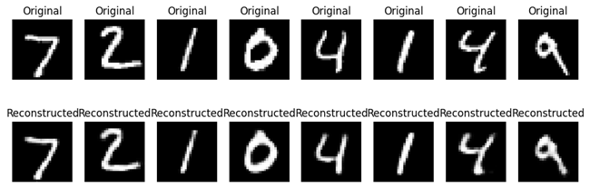
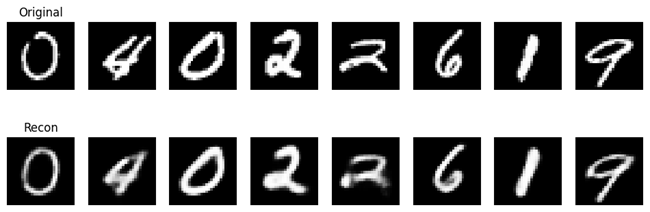
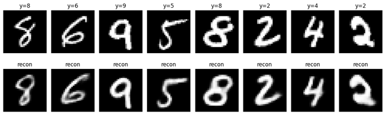

# 🧠 Non-Transformer AI Models
This repository showcases a collection of classic generative models implemented in PyTorch, applied to both image (MNIST) and text datasets. Each folder is a self-contained project with its own training script, requirements, results, and documentation. The goal is to demonstrate how Autoencoders, VAEs, GANs, DCGANs, and Diffusion models work without transformers, serving as an educational baseline for modern generative AI.

## 📂 Repository Structure
non-transformer-ai-models/  
│── autoencoder-mnist/  
│── cvae-mnist/  
│── cvae-text/  
│── dcgan-mnist/  
│── diffusion-mnist/  
│── gan-mnist/  
│── text-autoencoder/  
│── text-diffusion/  
│── vae-mnist/  
│── vae-text/  
│── LICENSE  
│── README.md  

Each subfolder contains:  
- Model implementation script (.py)  
- Training results & outputs (.png)  
- requirements.txt  
- README.md with detailed explanation  

## 1. Autoencoder (MNIST)
Learns compressed latent features of handwritten digits.  
  
  
[Details](autoencoder-mnist/README.md)  

## 2. Variational Autoencoder (VAE – MNIST)
Introduces probabilistic latent space using reparameterization trick.  
  
  
[Details](vae-mnist/README.md)  

## 3. Conditional Variational Autoencoder (CVAE – MNIST)
Generates digits conditioned on labels.  
  
  
[Details](cvae-mnist/README.md)  

## 4. GAN (MNIST)
Classic adversarial training with Generator & Discriminator.  
  
  
[Details](gan-mnist/README.md)  

## 5. DCGAN (MNIST)
Convolutional GAN for more stable training & sharper images.  
  
  
[Details](dcgan-mnist/README.md)  

## 6. Diffusion Model (MNIST)
Noise-to-image generation using denoising steps.  
  
  
[Details](diffusion-mnist/README.md)  

## 7. Text Autoencoder
Seq2Seq model reconstructing sentences via LSTM encoder–decoder.  
Example: `Original: i love deep learning` → `Reconstructed: i love deep learning`  
[Details](text-autoencoder/README.md)  

## 8. Text VAE
Learns latent distribution for sentences and generates new text.  
Example: `Generated: i like machine learning`  
[Details](vae-text/README.md)  

## 9. Conditional VAE (Text)
Conditioned on sentiment labels for text generation.  
Examples:  
- Label 0 (Neutral): `i love deep learning`  
- Label 1 (Positive): `an excellent performance`  
- Label 2 (Negative): `a very bad script`  
[Details](cvae-text/README.md)  

## 10. Text Diffusion
Applies diffusion-style denoising to text sequences.  
Example: `Corrupted: dogs` → `Reconstructed: i love dogs`  
[Details](text-diffusion/README.md)  

## ⚡ Installation
```bash
git clone https://github.com/shubham-61291/non-transformer-ai-models.git
cd non-transformer-ai-models

👨‍💻 Author

Shubham Singh

📜 License

MIT License
