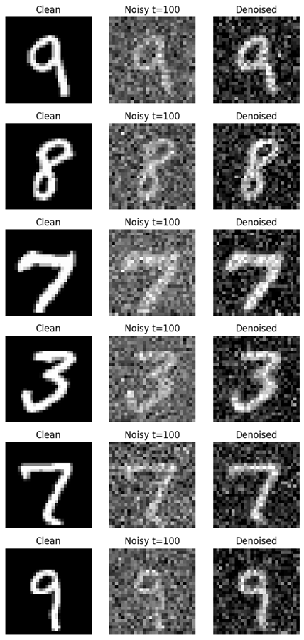

# Diffusion Model (MNIST) 📖 Overview

This project implements a simple diffusion model trained on the MNIST dataset. The model demonstrates the forward process of adding noise to images and the reverse denoising process to generate digits from pure noise.

---

## 🚀 Key Features
✅ Forward diffusion with configurable timesteps  
✅ Lightweight U-Net style denoising model  
✅ Visualization of noisy and denoised outputs  
✅ Intermediate sampling at timesteps (100, 150, 200)  
✅ Final digit generation from random noise  

---

## 🛠 Tech Stack
Framework: PyTorch  
Dataset: MNIST (via torchvision)  
Libraries: Torch, Torchvision, Matplotlib  
Optimizer: Adam  
Loss: MSE (Mean Squared Error)  

---

## 📂 Project Structure
diffusion-mnist/  
│── diffusion image model.py    # Diffusion implementation and training  
│── output.png                  # Clean, noisy, denoised samples  
│── sample at t = 100.png       # Generated digits at step 100  
│── sample at t = 150.png       # Generated digits at step 150  
│── sample at t = 200.png       # Generated digits at step 200  
│── final sample.png            # Final generation from noise  
│── training loss.png           # Training loss curve  
│── requirements.txt            # Dependencies  
│── README.md                   # Documentation  
│── .gitkeep                    # Track folder in git  

---

## ⚡ Installation
git clone https://github.com/shubham-61291/non-transformer-ai-models.git  
cd "diffusion-mnist"  
pip install -r requirements.txt  

---

## ▶️ Usage
python "diffusion image model.py"  

This will train the diffusion model, save intermediate results, and produce final generated samples.

---

## 🖼 Demo

🔹 **Training Loss Curve**  

🔹 **Output Visualization**  

🔹 **Sampling Steps**  
t=100:  
  

t=150:  
  

t=200:  
  

🔹 **Final Sample**  

---

## 🔮 Future Enhancements
🔹 Add proper U-Net with timestep embeddings  
🔹 Train on complex datasets like CIFAR-10 or CelebA  
🔹 Implement classifier-free guidance  
🔹 Explore advanced noise schedules  

---

## 👨‍💻 Author
Shubham Singh

---

## 📜 License
MIT License
